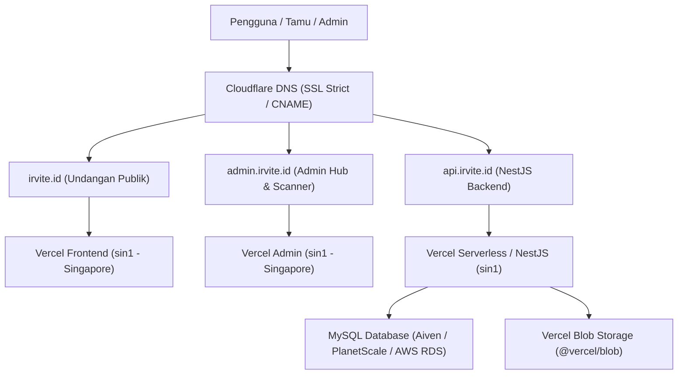

# IRVITE.ID - Panduan Deployment, Migrasi Database & Disaster Recovery

Dokumen ini menjelaskan alur deployment resmi, aturan keamanan migrasi database Prisma, prosedur pencadangan (backup), dan langkah pemulihan (rollback / restore) untuk platform **IRVITE.ID**.

---

## 1. Arsitektur Lingkungan Produksi

Platform IRVITE berjalan di atas infrastruktur hybrid modern:



- **Domain Utama**: `irvite.id` (Aset undangan publik, portal kelola tamu, landing page, katalog template).
- **Subdomain Admin**: `admin.irvite.id` (Dasbor operasional, manajemen tamu, scanner QR check-in).
- **Subdomain API**: `api.irvite.id` (REST API backend, otentikasi JWT HttpOnly, endpoint sinkronisasi).
- **Media Storage**: `@vercel/blob` untuk penyimpanan foto pre-wedding, musik, galeri, dan aset kustom secara permanen.

---

## 2. Alur Migrasi Database Prisma yang Aman (Zero-Downtime)

### Prinsip Utama
1. **Tidak Ada Raw DDL di Runtime**: Dilarang menjalankan query DDL seperti `ALTER TABLE` atau `CREATE TABLE` di kode runtime aplikasi (`PrismaService`). Semua perubahan skema wajib melalui file migrasi Prisma resmi (`packages/database/prisma/migrations/`).
2. **Fail-Fast (Tanpa `|| true`)**: Perintah migrasi pada deployment diatur tanpa fallback `|| true`:
   ```bash
   npx prisma migrate deploy --schema=../../packages/database/prisma/schema.prisma
   ```
   Jika migrasi database gagal, build deployment akan langsung **GAGAL**, mencegah rilis kode baru di atas skema yang tidak sinkron.

### Tahapan Membuat Migrasi Baru
1. Ubah `packages/database/prisma/schema.prisma` di branch lokal.
2. Buat file migrasi SQL:
   ```bash
   npx prisma migrate dev --name <deskripsi_perubahan>
   ```
3. Periksa isi file `packages/database/prisma/migrations/<timestamp>_<nama>/migration.sql`.
4. Jalankan pengujian lokal:
   ```bash
   npm run verify
   ```
5. Buat backup database sebelum perubahan skema diaplikasikan ke lingkungan produksi.

---

## 3. Prosedur Backup Database

### A. Backup Otomatis Cloud (Direkomendasikan)
Aktifkan fitur **Automated Daily Backups** dan **Point-in-Time Recovery (PITR)** pada dashboard database cloud provider Anda (Aiven, PlanetScale, Railway, atau AWS RDS). Pastikan retensi backup minimal **7-14 hari**.

### B. Backup Manual Sebelum Migrasi Besar
Gunakan skrip PowerShell otomatis yang disediakan:
```powershell
.\scripts\backup-db.ps1 -OutputDir ".\backups" -KeepDays 14
```
Skrip ini akan:
1. Membaca koneksi `DATABASE_URL` dari `.env`.
2. Mengekspor seluruh skema, data, trigger, dan rutin ke file `backups/backup_<dbname>_<timestamp>.sql`.
3. Memastikan file dump terbentuk dengan benar (> 0 byte).

---

## 4. Prosedur Rollback & Pemulihan (Disaster Recovery)

Jika terjadi kendala kritis pasca-deployment:

### Langkah 1: Rollback Versi Aplikasi di Vercel
1. Buka dashboard Vercel untuk project terkait (`web-invitation`, `web-admin`, atau `api-server`).
2. Masuk ke tab **Deployments**.
3. Cari deployment stabil sebelumnya (status Ready).
4. Klik menu opsi (...) pada deployment tersebut lalu pilih **Instant Rollback**.
5. Traffic akan seketika dialihkan kembali ke build stabil tanpa perlu build ulang.

### Langkah 2: Restore Database (Jika Diperlukan)
Jika data atau skema mengalami kerusakan:
1. Pastikan koneksi database tidak sedang menerima traffic baru (aktifkan mode maintenance atau rollback aplikasi terlebih dahulu).
2. Jalankan pemulihan dari file dump terakhir:
   ```bash
   mysql -h <host> -P <port> -u <user> -p <database_name> < backups/backup_<dbname>_<timestamp>.sql
   ```
3. Verifikasi status skema Prisma:
   ```bash
   npx prisma migrate status --schema=packages/database/prisma/schema.prisma
   ```
4. Jalankan health check API:
   ```bash
   npm run test:smoke
   ```

