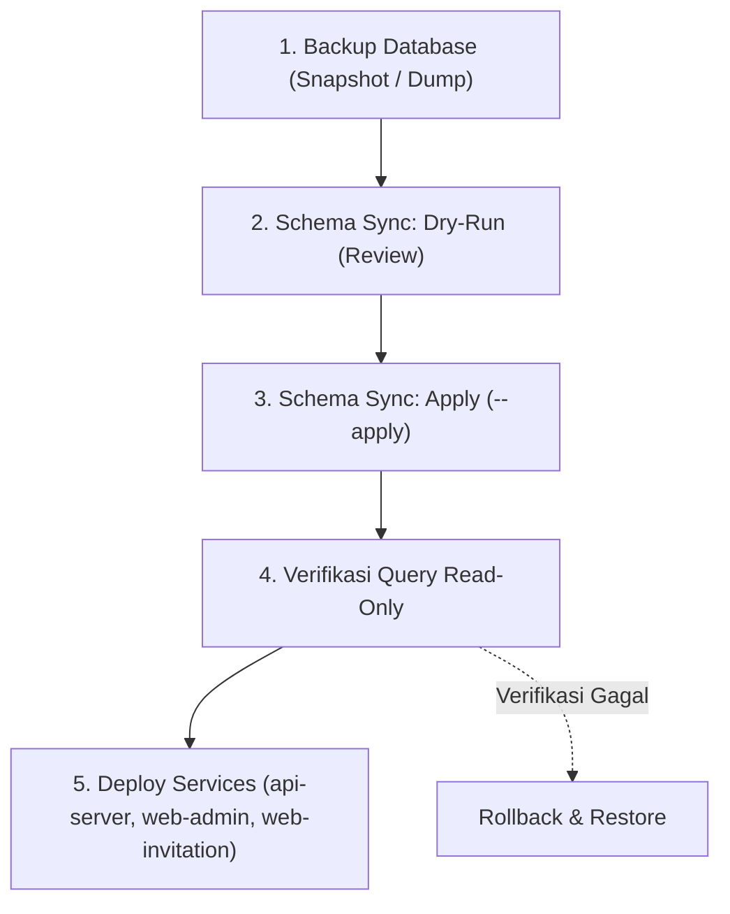

# SOP Deploy Hardening & Schema Synchronization

Dokumen ini mendokumentasikan prosedur standar operasional (SOP) untuk rilis hardening produksi pada platform **IRVITE.ID**. Prosedur ini memisahkan migrasi/sinkronisasi DDL dari proses *startup/cold-start* aplikasi dan mewajibkan eksekusi terkontrol oleh operator.

---

## 1. Urutan Rilis Produksi (Execution Flow)



### Langkah 1: Backup Database (Snapshot / Dump)
Sebelum menjalankan mutasi skema atau migrasi apa pun, ambil snapshot database secara penuh:
```bash
# Contoh mysqldump untuk database MySQL/MariaDB
mysqldump -u <USER> -p -h <HOST> --single-transaction --quick --routines --triggers <DATABASE_NAME> > backup_pre_hardening_$(date +%Y%m%d_%H%M%S).sql
```

### Langkah 2: Schema Sync Dry-Run (Simulasi)
Jalankan skrip sinkronisasi tanpa flag `--apply`. Mode default adalah **DRY-RUN** yang tidak melakukan mutasi apa pun ke database:
```bash
npm run schema:sync
# atau
node scripts/schema-sync.cjs
```
- Periksa log keluaran:
  - `[DRY-RUN: ALREADY EXIST]`: Kolom/tabel sudah ada.
  - `[DRY-RUN: WOULD APPLY]`: Pernyataan DDL yang akan dieksekusi.
  - `[DRY-RUN: WOULD IMPORT]`: Deteksi migrasi konfigurasi harga master satu kali dari `activity_logs`.
- Jika ingin meninjau kandidat data yatim (orphaned records):
```bash
node scripts/schema-sync.cjs --clean-orphans
```

### Langkah 3: Eksekusi Mutasi Skema (`--apply`)
Setelah hasil simulasi dry-run ditinjau dan disetujui oleh operator, jalankan mutasi dengan flag `--apply`:
```bash
ALLOW_PROD_SCHEMA_SYNC=true node scripts/schema-sync.cjs --apply
```
Jika pembersihan data yatim (*orphan cleanup*) juga diperlukan:
```bash
# Perhatian: Menolak jika COUNT(events) = 0 atau kandidat hapus > 50 baris kecuali disertai --force
ALLOW_PROD_SCHEMA_SYNC=true node scripts/schema-sync.cjs --apply --clean-orphans

# Jika kandidat hapus > 50 baris dan telah divalidasi oleh operator:
ALLOW_PROD_SCHEMA_SYNC=true node scripts/schema-sync.cjs --apply --clean-orphans --force
```

### Langkah 4: Verifikasi Query Read-Only
Lakukan eksekusi query verifikasi *read-only* (lihat Bagian 2) untuk memastikan seluruh tabel, kolom, dan indeks telah aktif dan kompatibel.

### Langkah 5: Deploy Layanan Aplikasi
Deploy container backend API dan frontend web:
1. `api-server` (NestJS)
2. `web-admin` (Next.js)
3. `web-invitation` (Next.js)

---

## 2. Query Verifikasi Read-Only

Jalankan query SQL berikut untuk memastikan integritas database setelah sinkronisasi skema:

### A. Verifikasi Keberadaan Tabel
```sql
SELECT 
    TABLE_NAME, 
    TABLE_ROWS, 
    CREATE_TIME 
FROM information_schema.TABLES 
WHERE TABLE_SCHEMA = DATABASE() 
  AND TABLE_NAME IN (
      'events', 
      'guests', 
      'invitations', 
      'orders', 
      'wishes', 
      'offline_sync_ops', 
      'activity_logs', 
      'master_pricing_configs', 
      'guests_migration_audit'
  );
```
*Ekspektasi: Seluruh tabel di atas muncul dalam hasil query.*

### B. Verifikasi Keberadaan Kolom Kritis
```sql
SELECT 
    TABLE_NAME, 
    COLUMN_NAME, 
    DATA_TYPE, 
    IS_NULLABLE, 
    COLUMN_DEFAULT 
FROM information_schema.COLUMNS 
WHERE TABLE_SCHEMA = DATABASE() 
  AND (
      (TABLE_NAME = 'guests' AND COLUMN_NAME IN ('table_number', 'is_walk_in')) OR
      (TABLE_NAME = 'events' AND COLUMN_NAME = 'active_until') OR
      (TABLE_NAME = 'orders' AND COLUMN_NAME IN ('options', 'pricing_version')) OR
      (TABLE_NAME = 'invitations' AND COLUMN_NAME IN ('first_opened_at', 'last_opened_at', 'open_count'))
  );
```
*Ekspektasi: Kolom `table_number`, `is_walk_in`, `active_until`, `options`, `pricing_version`, dan `open_count` tersedia.*

### C. Verifikasi Konfigurasi Harga Master
```sql
SELECT 
    id, 
    version, 
    created_by, 
    created_at 
FROM master_pricing_configs 
ORDER BY version DESC, created_at DESC 
LIMIT 5;
```
*Ekspektasi: Jika ada konfigurasi harga aktif, minimal 1 baris record versi master pricing tersedia.*

### D. Verifikasi Konsistensi Data Yatim (Orphan Check)
```sql
SELECT 
    (SELECT COUNT(*) FROM orders WHERE event_id NOT IN (SELECT id FROM events)) AS orphan_orders,
    (SELECT COUNT(*) FROM wishes WHERE event_id NOT IN (SELECT id FROM events)) AS orphan_wishes,
    (SELECT COUNT(*) FROM offline_sync_ops WHERE event_id NOT IN (SELECT id FROM events)) AS orphan_sync_ops;
```
*Ekspektasi: Nilai orphan adalah 0 setelah pembersihan atau dalam batas toleransi wajar.*

---

## 3. Prosedur Rollback

### A. Skema Kompatibilitas Maju-Mundur (Additive by Design)
Seluruh perubahan DDL yang didefinisikan dalam `scripts/schema-sync.cjs` bersifat **aditif**:
- Kolom baru selalu bersifat `NULL` atau memiliki nilai `DEFAULT`.
- Tabel baru menggunakan `CREATE TABLE IF NOT EXISTS`.
- Tidak ada penghapusan kolom (`DROP COLUMN`) atau pengubahan tipe data yang merusak data lama.

Dengan desain ini:
- Jika deployment aplikasi versi baru dibatalkan (*reverted* ke versi commit sebelumnya), aplikasi versi lama **tetap dapat berjalan normal** di atas database yang telah disinkronkan tanpa error.

### B. Rollback Aplikasi (Service Revert)
Jika terjadi kendala pada container aplikasi setelah rilis:
1. Revert deployment Vercel / Cloud Run ke commit stabil sebelumnya:
   ```bash
   git checkout origin/main
   # Deploy ulang hash lama
   ```
2. Tidak perlu melakukan rollback DDL database jika tidak ada kerusakan data, karena skema aditif tidak mengganggu versi lama.

### C. Rollback Database Darurat (Catastrophic Restore)
Jika terjadi kegagalan fatal pada data selama eksekusi `--apply`:
1. Hentikan traffic masuk ke API server (alihkan ke halaman pemeliharaan).
2. Restore database dari snapshot backup:
   ```bash
   mysql -u <USER> -p -h <HOST> <DATABASE_NAME> < backup_pre_hardening_YYYYMMDD_HHMMSS.sql
   ```
3. Lakukan verifikasi konsistensi data sebelum membuka kembali traffic aplikasi.
